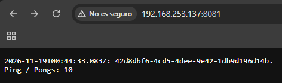

<div align="center">

# 🚀 Version 2.1: Connecting pods

[](https://kubernetes.io/)
[](https://www.docker.com/)
[](https://nodejs.org/)

</div>

---

## 🎯 Exercise Instructions

Connect the Log output application and the Ping pong application with HTTP. So, instead of sharing data via files, use an HTTP GET endpoint in the Ping pong app to respond with the number of pongs for the Log output app. Remove the volume between the two applications for the time being.

---

## 📦 Docker Images

Published on Docker Hub:
- [`arianesec/log-output:2.1`](https://hub.docker.com/r/arianesec/log-output)
- [`arianesec/pingpong:2.1`](https://hub.docker.com/r/arianesec/arianesec/pingpong)
---

## 🛠️ Deployment & Execution

Follow these steps to set up the cluster and deploy the application:

```bash
# Navigate to the project directory
cd pingpong_log_output

# Create the k3d cluster with port mapping
k3d cluster create -p 8081:80@loadbalancer --agents 2

# Apply Kubernetes manifests
kubectl apply -f manifests/pingpong.yaml -f manifests/log_output.yaml -f manifests/ingress.yaml

# Confirm it's running
kubectl get pods,svc,ing
```
# Result
