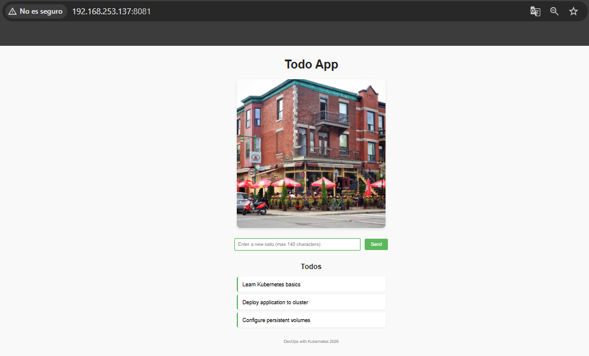

<div align="center">

# 🚀 Version 1.13: The project, step 7

[](https://kubernetes.io/)
[](https://www.docker.com/)
[](https://nodejs.org/)

</div>

---

## 🎯 Exercise Instructions

It is time to start adding some real functionality to our project! As promised earlier, the project shall have a todo app functionality. So in this exercise

add an input field. The input should not take todos that are over 140 characters long.
add a send button. It does not have to send the todo yet.
add a list of the existing todos with some hardcoded todos.

---

## 📦 Docker Images

Published on Docker Hub:
- [`arianesec/todo-app:1.13`](https://hub.docker.com/r/arianesec/todo-app)

---

## 🛠️ Deployment & Execution

Follow these steps to set up the cluster and deploy the application:

```bash
# Navigate to the project directory
cd the_project/todo_app

# Create the k3d cluster with port mapping
k3d cluster create -p 8081:80@loadbalancer --agents 2
docker exec k3d-k3s-default-agent-0 mkdir -p /tmp/kube

# Apply Kubernetes manifests
kubectl apply -f manifests

# Confirm it's running
kubectl get pods,svc,ing
```
# Result
