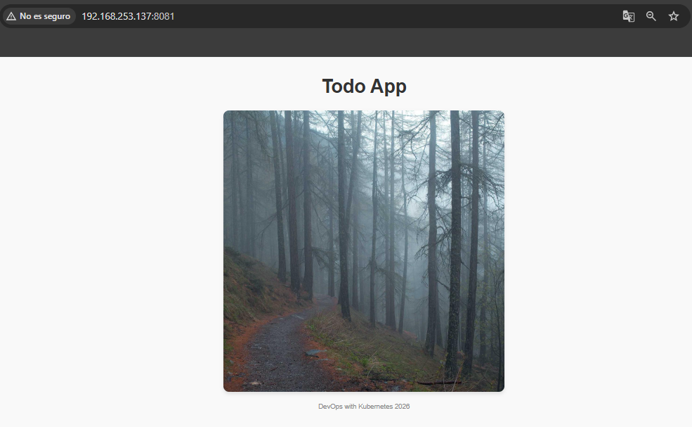

<div align="center">

# 🚀 Version 1.12: The project, step 6

[](https://kubernetes.io/)
[](https://www.docker.com/)
[](https://nodejs.org/)

</div>

---

## 🎯 Exercise Instructions

Since the project looks a bit boring right now, let's add a picture!

The goal is to add an hourly image to the project.

Get a random picture from Lorem Picsum like https://picsum.photos/1200 and display it in the project. Find a way to store the image so it stays the same for 10 minutes.

After 10 minutes have passed, you might give the old pic still one more time, and for the next request, there should be a new picture
Make sure to cache the image into a persistent volume so that the API isn't needed for new images every time we access the application or the container crashes.

The best way to test what happens when your container shuts down is likely by shutting down the container, so you can add logic for that as well, for testing purposes.

---

## 📦 Docker Images

Published on Docker Hub:
- [`arianesec/todo-app:1.12`](https://hub.docker.com/r/arianesec/todo-app)

---

## 🛠️ Deployment & Execution

Follow these steps to set up the cluster and deploy the application:

```bash
# Navigate to the project directory
cd the_project/todo_app

# Create the k3d cluster with port mapping
k3d cluster create -p 8081:80@loadbalancer --agents 2
docker exec k3d-k3s-default-agent-0 mkdir -p /tmp/kube

# Apply Kubernetes manifests
kubectl apply -f manifests

# Confirm it's running
kubectl get pods,svc,ing
```
# Result
